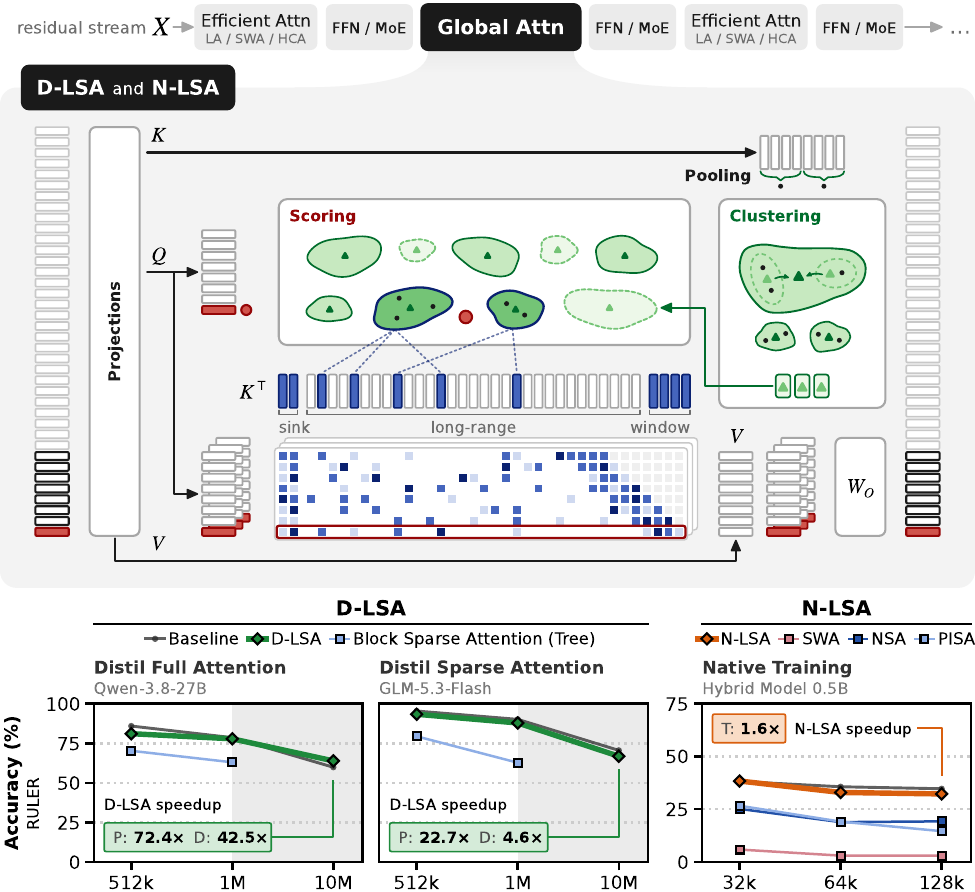

# Latent Sparse Attention

**Towards Subquadratic Ultra-Long Context Attention**

[](https://arxiv.org/abs/2610.42147)
[](https://github.com/Prefrontal-AI/sglang/tree/lsa-v0.1.0)
[](https://github.com/orgs/Prefrontal-AI/packages/container/package/sglang)
[](LICENSE)



*One global attention layer under D-LSA and N-LSA. Keys are pooled and clustered into buckets, and a query scores the bucket centroids, then attends only to the selected long-range keys plus the sink and window.*

## TL;DR

Latent Sparse Attention (LSA) clusters keys hierarchically in a learned latent space, and each query scores the clusters instead of every key.
Prefill, decode and training get faster at long context, while accuracy stays close to the original model's.

- **D-LSA** (Distilled) is applied to a pre-trained model by distilling its indexer.
  On GLM-5.3-Flash at 10M tokens it speeds up one attention layer by 22.7x in prefill and 4.6x in decode over the model's own sparse attention.
  On Qwen3.8-27B it is 72.4x and 42.5x faster than full attention.
- **N-LSA** (Native) is trained from scratch on the next-token loss alone.
  It matches the accuracy of full attention, and its training is 1.6x faster per layer at 128k tokens.

The attention kernel is unchanged.
LSA only decides which keys it reads.

## Contents

| Method | Paper name | Where |
|---|---|---|
| Distilled LSA, flat search | D-LSA (Flat) | `src/lsa/core`, served by `src/lsa/sglang` |
| Distilled LSA, tree search | D-LSA (Tree) | same |
| Training-free LSA, a PCA map | D-LSA (Training-Free) | same |
| Distillation of the index space | - | `src/lsa/training/distillation` |
| Native LSA and the native baselines (Full Attention, SWA, NSA, PISA) | N-LSA | `src/lsa/training/native` |
| Served baselines | Block Sparse Attention (Flat, Tree) | `src/lsa/baselines` |
| Accuracy, kernel and end-to-end evaluations | - | `src/lsa/evaluation` |

Everything runs through one command, `lsa`.

## Installation

Python 3.12 and [uv](https://docs.astral.sh/uv/) are needed.

```bash
git clone https://github.com/Prefrontal-AI/latent-sparse-attention.git
cd latent-sparse-attention
uv sync --locked --extra evaluation --extra training
uv run lsa --help
```

The `training` extra builds `causal-conv1d`, which needs the CUDA toolkit.
Without `nvcc`, add `--no-install-package causal-conv1d`.
For evaluation alone, use `uv sync --locked --extra evaluation`.

The results in the paper were measured on NVIDIA H200 GPUs.

## Quick start: serve a model with LSA

LSA is an SGLang plugin.
It runs in the serving image of our [SGLang fork](https://github.com/Prefrontal-AI/sglang/tree/lsa-v0.1.0), which adds the context-parallel and long-context support the 10M-token runs need.
LSA itself is not in the image - you install this repository into it.

Pull the image and start a container with this repository, a distilled map and the Hugging Face cache mounted.
The image is built with CUDA 13.0.3, and B300 (Blackwell) nodes take their own image, tagged `lsa-v0.1.0-b300`.
To build it from source, run the fork's `docker/enroot/build.sh` at the tag, from a checkout of it - it needs Docker with buildx and enroot, no GPU, and writes `sglang-lsa-<sha10>.sqsh`, where `<sha10>` is the first 10 characters of the commit (`042d955ba3` for `lsa-v0.1.0`).
`--cuda <version>` builds against another CUDA version, `--ref <commit>` another commit and `--out-dir <dir>` writes elsewhere.

With Docker, which needs the NVIDIA container runtime:

```bash
docker pull ghcr.io/prefrontal-ai/sglang:lsa-v0.1.0
docker run -it --rm --gpus '"device=0"' --shm-size 32g --network host -e HF_HOME=/hf \
  -v $PWD:/workspace/latent-sparse-attention:ro -v <maps directory>:/maps:ro -v $HF_HOME:/hf \
  ghcr.io/prefrontal-ai/sglang:lsa-v0.1.0 bash
```

Docker refuses a symlink as a mount source, so pass real directories.

With enroot on Slurm, which needs no GPU to import:

```bash
enroot import -o sglang-lsa-042d955ba3.sqsh 'docker://ghcr.io#prefrontal-ai/sglang:lsa-v0.1.0'
enroot create --name lsa sglang-lsa-042d955ba3.sqsh
enroot start --rw -e HF_HOME=/hf -m $PWD:/workspace/latent-sparse-attention \
  -m <maps directory>:/maps -m $HF_HOME:/hf lsa bash
```

The import takes about 10 minutes and `enroot create` about 20, so create the container once and reuse it.

Inside the container, install this repository and pass an `lsa` block in the model config:

```bash
pip install --no-deps /workspace/latent-sparse-attention
python -m sglang.launch_server --model-path Qwen/Qwen3.8-27b --tp 1 \
  --attention-backend fa3 --page-size 1 --disable-prefill-cuda-graph \
  --json-model-override-args '{"lsa": {"projections": "/maps/qwen38_27b.pt", "query_heads": "all"}}'
```

`--disable-prefill-cuda-graph` is required.
LSA selects keys for a prefill on the host, which a CUDA graph cannot capture, so without the flag the server crashes during startup.
Decode is still captured.

The plugin registers through SGLang's `sglang.srt.plugins` entry point and arms itself from the `lsa` block.
The server log prints `armed` when it does.
Without that line, the server is running the checkpoint's own attention.
The line appears before startup finishes, so wait for `/health` and send a request:

```bash
curl -s localhost:30000/v1/completions -H 'Content-Type: application/json' \
  -d '{"model": "Qwen/Qwen3.8-27b", "prompt": "The capital of France is", "max_tokens": 32}'
```

Every key of the block defaults to the paper's flat design, and `docs/reference/notation.md` names each one.
`projections` is a distilled map: train one (see [Distillation](#distillation)), or use the maps of the `d-lsa-weights-v1` release, see [Weights](#weights).
On a machine without internet access, download the model first and add `-e HF_HUB_OFFLINE=1` to `docker run` or `enroot start`.

For GLM-5.3-Flash, the full server settings are in `configs/evaluation/accuracy/glm53_flash/lsa_flat_early_budget_tp8.yaml`.

## Reproducing the paper

The evaluation harness starts the server, runs a suite against it and writes a record.
Each command below submits a Slurm job through a *site* (see [Running on a cluster](#running-on-a-cluster)).
Add `--dry-run` to print what would be submitted.

Configs are named `<method>_<mesh>[_<slice>].yaml` under one directory per model, `qwen38_27b` or `glm53_flash`:

| Paper method | Config stem |
|---|---|
| Full Attention | `full` (Qwen3.8-27B) |
| Block Sparse Attention (Flat) | `qsa` on Qwen3.8-27B, `native` on GLM-5.3-Flash - each model's own indexer |
| Block Sparse Attention (Tree) | `pisa_c8` |
| D-LSA (Flat) | `lsa_flat`, and `lsa_flat_early_budget` on GLM-5.3-Flash |
| D-LSA (Tree) | `lsa_tree` |
| D-LSA (Training-Free) | `lsa_flat_pca` |

### Accuracy (Section 4.2)

Prepare RULER once for the model's tokenizer, then score a config.
Preparation is deterministic - every haystack source is pinned by checksum, so the sets match the paper's byte for byte.

```bash
lsa --site mycluster data prepare ruler --tokenizer Qwen/Qwen3.8-27b \
  --root <root>/benchmarks-qwen38 --lengths 4096 32768 --cpus 16 --mem-gb 64 --hours 2
lsa --site mycluster evaluate accuracy configs/evaluation/accuracy/qwen38_27b/lsa_flat_tp1.yaml \
  data.suite=ruler "data.tasks=[ruler]" "data.lengths=[4096,32768]" \
  run.output=<dir> --gpus 1 --hours 4
```

`data.tasks=[ruler]` selects every RULER task, and `data.lengths` narrows the cells.
For GLM-5.3-Flash, drop `--tokenizer` and `--root`, since its tokenizer is the default.
Add `--fetch-in-job` to `data prepare` when the machine you submit from has no network access but the compute nodes do.

Expected results, RULER mean over 13 tasks of 100 rows each, from a clean checkout:

| Run | 4k | 32k | Paper 4k | Paper 32k | Wall time |
|---|---|---|---|---|---|
| Qwen3.8-27B, D-LSA (Flat), 1 H200 | 0.974 | 0.968 | 0.975 | 0.966 | 1 h 52 min |
| GLM-5.3-Flash, D-LSA (Flat) with early budget, 8 H200 | 0.973 | 0.968 | 0.973 | 0.968 | about 40 min |

`data.suite` also takes `papertrail`, `full` and `smoke` (four rows per task, for a quick check).
`full_tp1.yaml` scores the dense baseline, which needs no map.

### Performance (Section 4.3)

```bash
# One attention layer on one GPU, prefill and decode, 128k to 10M tokens
lsa --site mycluster evaluate kernels configs/evaluation/kernels/glm53_flash/lsa_flat.yaml
# Complete served requests end to end
lsa --site mycluster evaluate production configs/evaluation/production/glm53_flash/lsa_flat_cp8.yaml
```

Swap the stem for each method, and `glm53_flash` for `qwen38_27b`.
The configs prefixed `b300_` measure on B300.

### Native training (Section 4.4)

The native arms pre-train a 24-layer hybrid model on 100B tokens of FineWeb-Edu at 4k, then decay at 128k on 12B tokens of LongDocs, each arm from its own checkpoint.
Each sparse arm reads about 2,560 keys per query in the decay.

| Arm | Pre-train | 128k decay |
|---|---|---|
| Full Attention | `pretrain_fineweb.yaml` | `decay_fineweb128k.yaml` |
| SWA | `pretrain_fineweb_window.yaml` | `decay_fineweb128k_window.yaml` |
| NSA | `nsam8.yaml` | `decay_fineweb128k_nsa.yaml` |
| PISA | `pisam8.yaml` | `decay_fineweb128k_pisa.yaml` |
| N-LSA | `pretrain_fineweb_lsa.yaml` | `decay_fineweb128k_lsa.yaml` |

```bash
lsa --site mycluster native train configs/training/native/qwen35_0_8b_gpt2/pretrain_fineweb_lsa.yaml --gpus 8
lsa --site mycluster native train configs/training/native/qwen35_0_8b_gpt2/decay_fineweb128k_lsa.yaml --gpus 8
lsa --site mycluster native evaluate configs/training/native/qwen35_0_8b_gpt2/decay_fineweb128k_lsa.yaml \
  --checkpoint <checkpoint> --suite benchmark
```

The configs live in `configs/training/native/qwen35_0_8b_gpt2/`, and its README lists the other presets.
Add `--dry-run` to print each resolved run before submitting it.

### Distillation

D-LSA learns its index space from a frozen model on documents drawn from LongDocs, then exports the map the server reads:

```bash
lsa --site mycluster distill targets configs/data/targets/qwen38_27b/long_16k_1m_heavy.yaml
lsa --site mycluster distill train configs/training/distillation/qwen38_27b/long_16k_1m_heavy_key_and_query_d2048.yaml
lsa distill export <run's maps.pt> <out.pt>
```

`long_16k_1m_heavy_key_and_query_d2048_smoke.yaml` runs a single step.

## Released artifacts

| Artifact | Needed for | Status |
|---|---|---|
| SGLang fork, tag `lsa-v0.1.0` | every served run | [available](https://github.com/Prefrontal-AI/sglang/tree/lsa-v0.1.0) |
| LongDocs, the long-document corpus | distillation and the native 128k decay | assembled from the hub with `lsa data prepare <source>`, see [data/longdocs](https://github.com/Prefrontal-AI/latent-sparse-attention/tree/main/data/longdocs) - the lock files are in [release `longdocs-locks-v1`](https://github.com/Prefrontal-AI/latent-sparse-attention/releases/tag/longdocs-locks-v1) |
| Agent traces `games` and `edgebench`, scrubbed | the distillation mix | [release `traces-v1`](https://github.com/Prefrontal-AI/latent-sparse-attention/releases/tag/traces-v1), see [the data guide](docs/guide/data.md#sources) |
| Distilled maps for Qwen3.8-27B and GLM-5.3-Flash | every `lsa_*` served config | [release `d-lsa-weights-v1`](https://github.com/Prefrontal-AI/latent-sparse-attention/releases/tag/d-lsa-weights-v1) |
| Checkpoints of the ten 128k decays of the native comparison, N-LSA and its baselines | `lsa native evaluate` | [release `n-lsa-weights-v1`](https://github.com/Prefrontal-AI/latent-sparse-attention/releases/tag/n-lsa-weights-v1) |
| PaperTrail | the `papertrail` suite | rebuilt from its kit, which is in the repository, with `lsa data prepare papertrail` - see [data/papertrail](https://github.com/Prefrontal-AI/latent-sparse-attention/tree/main/data/papertrail) |
| RULER haystack sources | `lsa data prepare ruler`, which rebuilds the paper's RULER sets byte for byte | [release `ruler-sources-v1`](https://github.com/Prefrontal-AI/latent-sparse-attention/releases/tag/ruler-sources-v1) |

### Weights

The distilled maps of D-LSA are assets of the release `d-lsa-weights-v1`, and the checkpoints of the native comparison, N-LSA included, of the release `n-lsa-weights-v1`.
Both unpack into the layout the configs read, under the site's `root` (`LSA_ROOT` overrides it).
The distilled maps are single files that go in `models/maps/`, where the `lsa_*` configs name them as `${root:models/maps/<name>.pt}`:

```bash
gh release download d-lsa-weights-v1 -R Prefrontal-AI/latent-sparse-attention --pattern '*.pt' --dir "$LSA_ROOT/models/maps"
```

A native checkpoint is a torchtitan step folder of 2.3 GB, split in two parts below the 2 GiB limit of a release asset.
There is one for each of the ten 128k decays of the comparison:

| Arm | Checkpoints | Configs under `configs/training/native/qwen35_0_8b_gpt2/` |
|---|---|---|
| Full Attention | `decay128k-dense` | `evaluate_released_dense.yaml` |
| SWA, window 2,560 and 4,608 | `decay128k-swa-2560`, `decay128k-swa-4608` | `evaluate_released_swa_2560.yaml`, `evaluate_released_swa_4608.yaml` |
| NSA, 2,048 and 4,096 selected keys | `decay128k-nsa-2048`, `decay128k-nsa-4096` | `evaluate_released_nsa_2048.yaml`, `evaluate_released_nsa_4096.yaml` |
| PISA, 2,368 and 4,416 keys | `decay128k-pisa-2368`, `decay128k-pisa-4416` | `evaluate_released_pisa_2368.yaml`, `evaluate_released_pisa_4416.yaml` |
| N-LSA, 1,024, 2,048 and 4,096 long-range keys | `decay128k-lsa-1024`, `decay128k-lsa-2048`, `decay128k-lsa-4096` | `evaluate_released_lsa_k1024.yaml`, `evaluate_released_lsa_k2048.yaml`, `evaluate_released_lsa_k4096.yaml` |

Join the parts of the ones you want and unpack them at the root, which creates `training/native/released/<checkpoint>/checkpoint/step-5866`:

```bash
gh release download n-lsa-weights-v1 -R Prefrontal-AI/latent-sparse-attention --pattern 'decay128k-lsa-2048.tar.part-*' --pattern SHA256SUMS --dir "$LSA_ROOT/downloads"
(cd "$LSA_ROOT/downloads" && sha256sum --check --ignore-missing SHA256SUMS && cat decay128k-lsa-2048.tar.part-* | tar -x -C "$LSA_ROOT")
lsa native evaluate configs/training/native/qwen35_0_8b_gpt2/evaluate_released_lsa_k2048.yaml --suite benchmark
```

Each config names its checkpoint, so no `--checkpoint` is needed.
The archive holds the step folder only.
The weights were trained with the paper's own trainer, which is not part of this repository, and the tensors are mapped to the names of this one, which a reload checks exactly.

## Running on a cluster

A site holds everything specific to one machine, and no run spells it.
It is `configs/site/<name>.yaml`, chosen with `lsa --site <name>`.
The default, `local`, is an example to copy.

<details>
<summary>A Slurm site</summary>

```yaml
# configs/site/mycluster.yaml
launcher: slurm
slurm:
  partition: <partition>
  account: <account>
root: /path/to/shared/storage/lsa
datasets: /path/to/shared/datasets
hf_home: /path/to/hub/cache
mounts: []
images:
  h200: /path/to/sglang-lsa-<sha10>.sqsh
  b300: ""
```

Every `slurm` key is optional, and an unset key adds no sbatch flag.
Large artifacts - targets, maps, records and logs - live under `root`.
`LSA_ROOT` and `HF_HOME` override `root` and `hf_home`, and `LSA_EXTRA_MOUNTS` adds directories to the serving container.
Jobs read the Hugging Face cache offline, so download a model first, for example `hf download Qwen/Qwen3.8-27b`.
`images` names the image built above, or a docker tag your runner can pull, and `run.image=<file or tag>` overrides it for one run.

</details>

## Documentation

| Document | Covers |
|---|---|
| `docs/guide/evaluation.md` | Accuracy, kernel and end-to-end evaluations |
| `docs/guide/training.md` | Distillation and native training |
| `docs/guide/data.md` | Preparing benchmarks, targets and corpora |
| `docs/guide/models.md` | Running LSA on another checkpoint, and the `lsa` block |
| `docs/guide/adapters.md` | Writing an adapter for a new model |
| `docs/guide/development.md` | Checks, tests and conventions |
| `docs/reference/notation.md` | Every symbol and config key, mapped to its name in the code |

## Development

```bash
make sync     # uv sync --locked
make format   # apply every fix a tool can make
make check    # lint, types and the tests the installed environment can run
```

The `gpu` and `cluster` test markers need a GPU and are deselected in CI.

## Citation

```bibtex
@misc{kubicek2026latentsparseattentionsubquadratic,
      title={Latent Sparse Attention: Towards Subquadratic Ultra-Long Context Attention}, 
      author={Ales Kubicek and Andrea Caciolai and Liangzu Peng and Sukrit Sumant and Benjamin Hoover and Fraser Greenlee and Ruairidh M. Battleday and Radim Urban and Torsten Hoefler and James C. R. Whittington},
      year={2026},
      eprint={2610.42147},
      archivePrefix={arXiv},
      primaryClass={cs.AI},
      url={https://arxiv.org/abs/2610.42147}, 
}
```

## License

Apache-2.0, see `LICENSE`.
Third-party code keeps its own license, see `THIRD_PARTY_NOTICES.md`.
The PaperTrail kit in `data/papertrail` is CC BY 4.0, by Sukrit Sumant, and the text of every dataset assembled from the hub keeps the license its source gave it, also in `THIRD_PARTY_NOTICES.md`.

## Acknowledgements

Serving builds on [SGLang](https://github.com/sgl-project/sglang).
The NSA training kernels are adapted from [flash-linear-attention](https://github.com/fla-org/flash-linear-attention).
Long-context accuracy uses [RULER](https://github.com/NVIDIA/RULER) and [LongBench v2](https://github.com/THUDM/LongBench).

## Contributors

- [Ales Kubicek](https://github.com/aleskubicek)
- [Andrea Caciolai](https://github.com/caciolai)
- [Liangzu Peng](https://github.com/liangzu)
- [Sukrit Sumant](https://github.com/SukritSumant)
